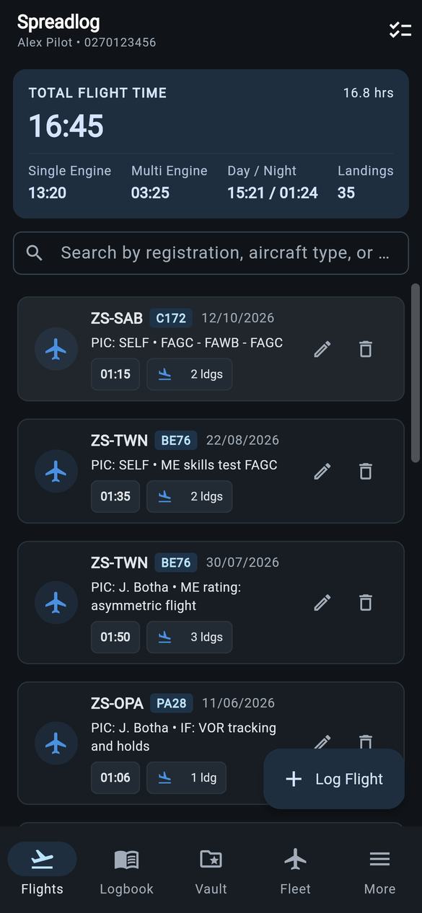
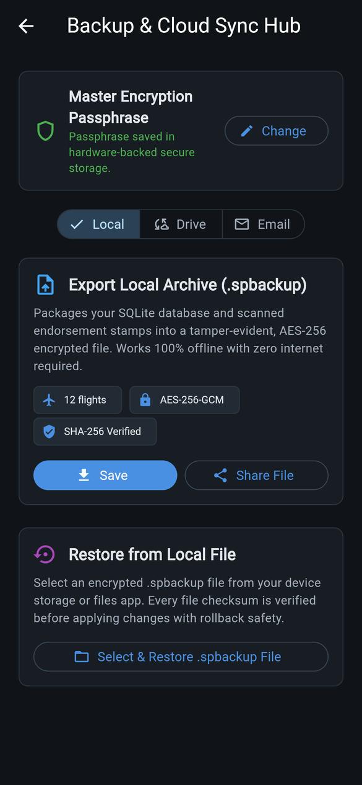
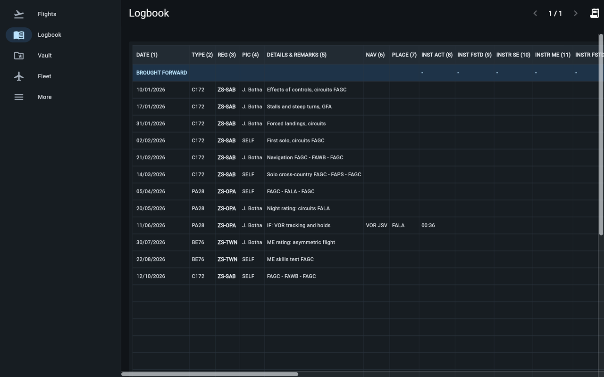
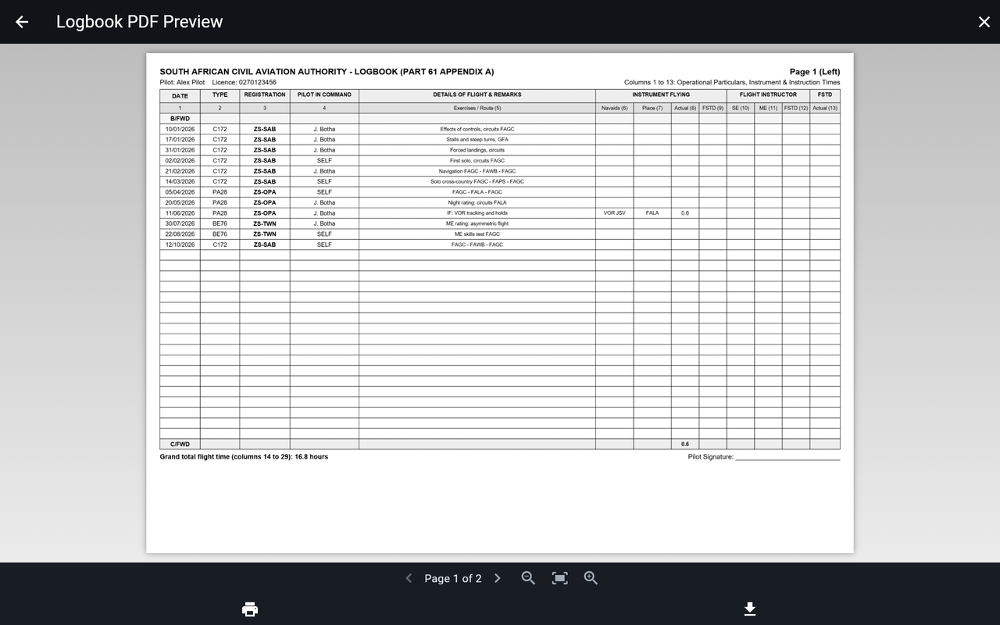
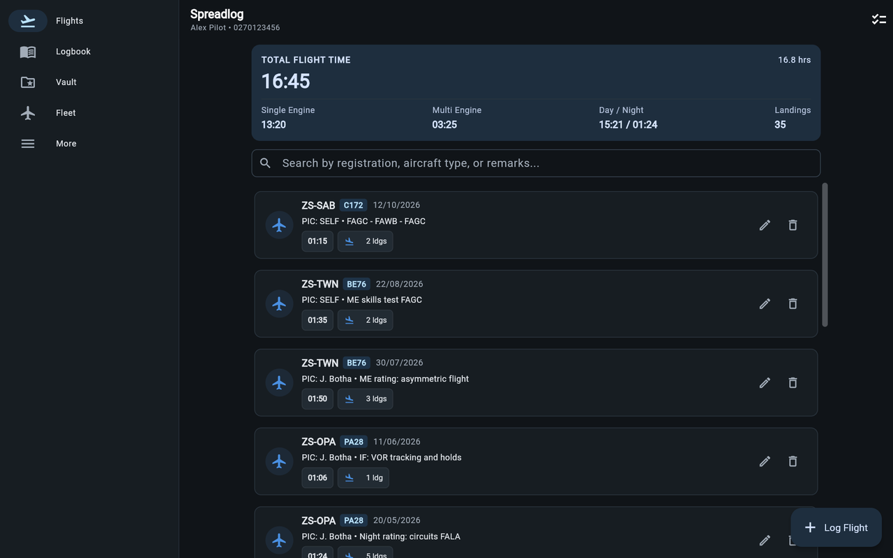

# Spreadlog

**An electronic pilot logbook built around the SACAA Part 61 logbook.**
Log flights once and Spreadlog keeps the 32-column ledger, page totals and
career summaries for you, prints them in the official layout, and keeps an
encrypted backup of everything, including your signed endorsement pages.

[**Open the web app**](https://spreadlog.incognitos.workers.dev) ·
[**Download for Android**](https://github.com/skmaiti2050/spreadlog/releases/latest) ·
[Design document](docs/DESIGN.md) ·
[License](LICENSE)

Free and open source. No account, no subscription, and no server holding
your logbook.

## Screenshots

<p>
  
  
</p>







Screenshots show sample data.

## Features

**Logbook**
- Flight entry for every SACAA column: single- and multi-engine time, day
  and night, PIC, PICUS, dual and co-pilot, instrument (actual and FSTD),
  instructor time, landings, navaids and place.
- Totals calculated in whole minutes, so they never drift from rounding.
- A spread view of the paper logbook: 30 lines a page, brought forward at
  the top and carried forward at the bottom.

**Reports**
- A printable logbook PDF in the SA-CATS 61 Appendix A layout.
- A career summary slip by aircraft type, up to any date.
- A reminder to print a paper copy every 90 days.
- Page-by-page preview with print, share or download.

**Endorsements and fleet**
- An endorsement vault for the instructor-signed pages: scanned on Android,
  stored as captured, and checked against a SHA-256 hash.
- An aircraft register with model endorsements.

**Backups**
- AES-256-GCM encrypted `.spbackup` archives, protected by your own
  passphrase.
- Save or share the file, back up to Google Drive (on Android, automatically
  in the background), email it to yourself through Gmail, or send it through
  your own SMTP server (Android).
- Restore on any device, with every file checked before anything is replaced.

## Get it

| Platform | How |
|---|---|
| **Web** | [spreadlog.incognitos.workers.dev](https://spreadlog.incognitos.workers.dev). Works in any modern browser and can be installed as an app (PWA). Your data stays in that browser's storage. |
| **Android** | Download the APK from the [latest release](https://github.com/skmaiti2050/spreadlog/releases/latest). Updates install over the previous version. [Obtainium](https://github.com/ImranR98/Obtainium) can keep it up to date. |

Scheduled Drive backups and SMTP backups need the Android app; browsers
can't run them in the background or open mail-server connections.

## Privacy

- Your logbook lives on your device (or in your browser). There is no
  Spreadlog server.
- Backups are encrypted on the device before they go anywhere.
- Google access is optional and limited to files Spreadlog itself creates
  in your Drive (`drive.file`) and sending email to yourself
  (`gmail.send.self`).

See the [privacy policy](https://spreadlog.incognitos.workers.dev/privacy).

## Build from source

Requirements: the Flutter stable SDK and, for Android, the Android SDK with
Java 17.

```bash
flutter pub get
dart run build_runner build --delete-conflicting-outputs   # Drift database code

# Web
dart run tool/update_web_assets.dart   # sqlite3.wasm and the Drift worker
flutter run -d chrome

# Android
flutter run
```

Release APKs are signed with the key named in `android/key.properties`
(not in the repo); without it, `flutter build apk --release` falls back to
the debug key. CI builds signed APKs on every push to `main` and publishes a
GitHub Release for each `v*` tag that matches the version in `pubspec.yaml`.

Architecture, domain rules and the original roadmap are in
[docs/DESIGN.md](docs/DESIGN.md); coding rules for contributors and AI agents
are in [AGENTS.md](AGENTS.md).

## License

Spreadlog is free and open source under the [Apache License 2.0](LICENSE).
See [NOTICE](NOTICE) for attribution and for the proprietary Google Play
services components used by the Android build.
